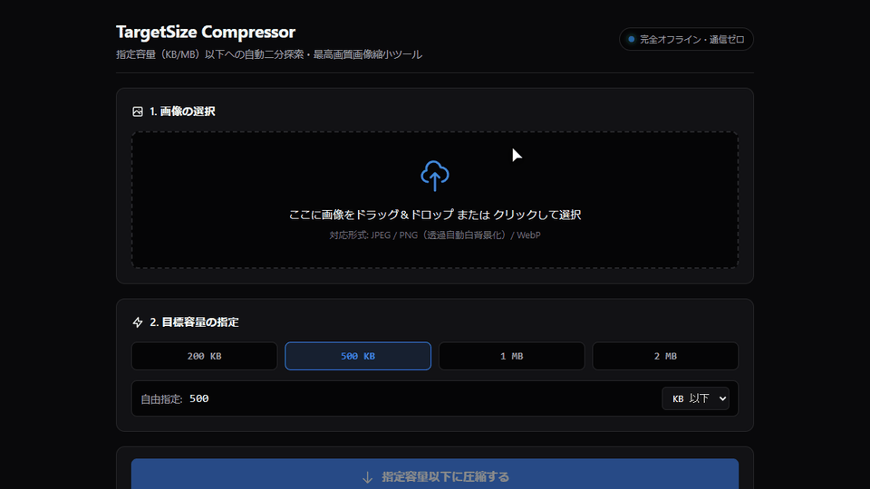

# TargetSize Compressor

## 画像を指定した容量以下へ自動縮小する完全ローカルWebツール



TargetSize Compressorは、役所手続き、履歴書エントリー、資格試験などで求められる「○○KB以下」「○MB以下」といった画像容量の制約に合わせて、画像をブラウザ内で圧縮・縮小するシンプルなWebツールです。

「500KB以下」のような目標容量を指定すると、JPEG品質を自動的に二分探索し、**目標容量以下で可能な限り高い品質**となる設定を求めます。

画像データは外部サーバーへ送信せず、ブラウザのCanvasとWeb APIだけで安全・高速に処理します。

---

## 主な特徴

### 🎯 指定容量を狙って自動圧縮
「200KB」「500KB」「1MB」「2MB」などのプリセット、または自由入力した容量を目標値として指定できます。
ユーザーが手動でJPEG品質スライダーを何度も試行錯誤する必要はありません。
自動二分探索によって、目標容量を超えない範囲でできるだけ高い品質値を自動決定します。

### 🔒 完全ローカル・サーバー送信なし
画像は外部サーバーへアップロードせず、お使いのブラウザ内だけで処理します。
そのため、証明写真や公的申請書類、機密文書など、外部ネットワークへ送信したくない画像にも安心して利用できます。

### 📦 外部ライブラリ不要（Vanilla JS）
外部ライブラリや重量フレームワークを使用せず、標準的なWeb APIだけで構成されています。
軽量で読み込みが早く、GitHub Pages等の静的ホスティングでそのまま動作します。

- HTML5
- Vanilla JavaScript (ES2020+)
- Canvas API / Image API
- Blob API / File API

### 🖼️ 透過PNGも安心の自動白背景処理
一般的なCanvasで透過PNGをそのままJPEG化すると透明部分が黒く塗りつぶされてしまう問題を防止するため、描画前に自動で白背景（`#FFFFFF`）を敷く安全処理を内蔵しています。

### 🔄 容量に収まらない場合は自動解像度縮小
JPEG品質を最低値まで下げても目標容量以下にならない場合、画像の解像度を段階的（0.85倍）に縮小して再探索します。
縮小時は常に元画像データから直接リサンプリングするため、画像の多重圧縮によるボケ（世代劣化）を防ぎます。

### ⚡ 直感的なドラッグ＆ドロップ対応
ファイル選択ダイアログはもちろん、ブラウザ画面へのドラッグ＆ドロップによる画像読み込みに標準対応しています。

---

## 主な機能

- 画像の選択（ファイルダイアログおよびドラッグ＆ドロップ対応）
- 透過画像の自動白背景合成（透過部分の黒塗り防止）
- 元画像の容量がすでに目標以下のときの案内・最適化
- 目標容量プリセット（200KB / 500KB / 1MB / 2MB）
- 目標容量の自由入力（KB / MB指定対応）
- 二分探索（最大8回）によるJPEG品質の自動最適化
- 容量オーバー時の自動解像度縮小（0.85倍フォールバック）
- 圧縮前後のファイルサイズ・解像度・削減率表示
- 圧縮後画像のプレビュー表示
- 圧縮後画像のワンクリックダウンロード（ファイル名に実容量を付与）

---

## 基本的な使い方

### 1. 画像を選択
画像ファイルをドロップゾーンにドラッグ＆ドロップするか、「ファイルを選択」ボタンから選択します。

### 2. 目標容量を指定
プリセット（200KB, 500KB, 1MB, 2MB）または自由入力欄から、希望する上限容量を指定します。

### 3. 自動圧縮
「圧縮する」ボタンをクリックすると、ツールがCanvas上で画像を処理し、目標容量に収まる最大品質を自動探索します。

### 4. 結果を確認
プレビュー画像とともに、以下の情報を確認できます。
- 元サイズ・解像度
- 変換後サイズ・解像度
- 容量削減率（%）

### 5. ダウンロード
「画像をダウンロード」ボタンを押すと、`[元ファイル名]_[変換後サイズ]KB.jpg` の形式で即座に保存されます。

---

## 圧縮アルゴリズム

TargetSize Compressorでは、JPEG品質を1段階ずつ総当たりするのではなく、**二分探索（Binary Search）**を用いて高速に最適値を特定します。

初期パラメータ：
```text
minQuality = 0.01
maxQuality = 1.00
最大ループ回数 = 8回
```

中間品質（`midQuality`）を計算し、非同期にJPEG Blobを生成：
```text
midQuality = round((minQuality + maxQuality) / 2, 2)
```

生成されたBlobのファイルサイズと目標容量を比較：
- **目標容量以下** → 現在の品質をベスト候補として保持し、さらに高品質側（`minQuality = midQuality`）を探索
- **目標容量超過** → 品質を下げる側（`maxQuality = midQuality`）を探索

最大8回の探索により、**「指定容量を超えない範囲での最高品質」**をわずか数回〜8回の試行で決定します。

---

## 容量に収まらない場合の解像度フォールバック

JPEG品質を最低値（0.01）まで下げても目標容量に収まらない場合は、品質低下だけで無理に合わせるのではなく、Canvasの解像度を段階的に縮小します。

```text
幅   = floor(現在の幅   × 0.85)
高さ = floor(現在の高さ × 0.85)
```

このとき、前回の縮小Canvasを再利用するのではなく、**常に読み込み済みのオリジナル画像から直接指定解像度で縮小描画**を行います。これにより、多重リサイズによる画質の劣化・ぼやけの蓄積を最小限に抑えます。

縮小後、再び品質探索（最大8回）を実行し、目標容量以下になるまでこのサイクルを繰り返します（最大10回まで試行）。

---

## 処理フロー

```text
画像ファイル選択（またはドラッグ＆ドロップ）
    ↓
Imageオブジェクト生成・読み込み
（※元サイズがすでに目標容量以下の場合は案内を表示）
    ↓
Canvas作成（初回は元画像サイズ）
    ↓
白背景で塗りつぶし（透過黒塗り防止）
    ↓
元画像からCanvasへ描画
    ↓
【品質二分探索ループ（最大8回）】
   ├─ midQualityでJPEG Blob生成 (非同期)
   ├─ 目標容量以下？
   │    ├─ YES → ベスト品質を更新し、より高品質側を探索
   │    └─ NO  → より低品質側を探索
   └─ 8回完了
    ↓
目標容量以下の品質が見つかった？
    ├─ YES ──> 最適Blobを確定 ──> 結果表示・ダウンロードへ
    └─ NO  ──> Canvas解像度を0.85倍へ縮小
                   ↓
              元画像から直接再描画して品質探索を再実行
              （最大10回 / 最小50pxまで）
```

---

## 対応画像とフォーマット仕様

- **入力対応形式**: ブラウザ標準でサポートされる画像形式（JPEG, PNG, WebP等）
  - ※iPhoneの標準形式である **HEIC/HEIF** 形式はブラウザ標準で非対応のため、JPEGまたはPNGに変換してから選択してください。
- **出力形式**: **JPEG (`image/jpeg`)**
- **透過画像の取り扱い**:
  - JPEGは透過（アルファチャンネル）を保持できません。
  - そのため、透明背景を持つPNG等の画像は、自動的に**白背景（#FFFFFF）**の上に重ねて描画・変換されます。

---

## ファイルサイズと容量単位について

- 目標値は「変換後ファイルの最大上限容量」として扱います。
- 内部処理では `1KB = 1024 Bytes`、`1MB = 1024 × 1024 Bytes` として計算します。
- 提出先システムによっては `1KB = 1000 Bytes` として厳格に判定される場合があるため、目標値に対してわずかな安全設計を考慮した探索を行います。
- ブラウザのJPEGエンコーダは可変長圧縮のため、目標容量に「完全に1バイト単位で一致」させるものではなく、「**指定容量を超えない範囲での最大画質**」を保証します。

---

## 削減率の計算

```text
削減率(%) = (元ファイルサイズ - 変換後ファイルサイズ) / 元ファイルサイズ × 100
```

表示例：
```text
元サイズ: 1.20MB (1920×1080)
変換後:   480KB  (1920×1080)
削減率:   60.0%  (画質: 82%)
```

---

## 推奨ファイル構成

```text
TargetSize-Compressor/
├─ index.html         # UIマークアップ・構造
├─ favicon.svg        # SVGファビコン
├─ ツール起動.bat     # Windowsワンクリック起動バッチ (Shift-JIS CP932)
├─ assets/            # デモ画像・公開用サンプル画像
│  ├─ demo.gif
│  ├─ zero-dev.png
│  ├─ sample-before.jpg
│  └─ sample-after.jpg
├─ css/
│  └─ style.css       # プロトコル第18条/プロジェクト統計ツール準拠ダークスタイル
├─ js/
│  ├─ config.js       # 共通設定定数・ユーティリティ関数
│  ├─ compressor.js   # コア画像圧縮・二分探索エンジン
│  └─ app.js          # UI制御・DnD・ダウンロード処理
├─ tests/             # 単体テスト・Playwright E2E実機テストスイート
├─ REVIEW_REPORT.md   # 独立品質監査報告書 (PASS)
├─ RECORD.md          # 開発記録・マイルストーン進捗管理
├─ README.md
└─ LICENSE
```

### ローカルでの起動方法
フォルダ内の **`ツール起動.bat`** をダブルクリックするだけで、既定ブラウザでツールが即座に起動します（Node.js等の事前インストールは不要です）。

静的Webサイトとして動作するため、GitHub Pages等にアップロードするだけで即座にWeb公開も可能です。

---

## 動作上の注意

- **透過背景**: PNG等の透過部分は自動的に白色になります。
- **HEIC形式**: iOS端末で撮影されたHEIC写真はそのまま読み込めません。JPEG等へ変換の上ご利用ください。
- **すでに容量以下の場合**: 既に目標容量を満たしている画像は、無駄な再圧縮による劣化を防ぐためそのままダウンロードするか再圧縮するかを選択できます。
- **高解像度写真**: 1200万〜4800万画素を超える巨大写真の場合、端末のスペックによってエンコードに数秒程度要する場合があります。
- **ダウンロード名**: 判別しやすいよう、保存ファイル名末尾に `_480KB.jpg` のように実容量が付与されます。

---

## サンプル画像クレジット

本リポジトリのデモおよび検証で使用しているサンプル画像は、以下のフリー素材を利用しています。

- **写真**: [Pexels - Areum Down](https://www.pexels.com/ja-jp/photo/13452880/)
- **撮影者**: Areum Down
- **元画像解像度**: 6960 × 4640 px (3:2)
- **ライセンス**: [Pexels License](https://www.pexels.com/license/)（商用利用可能・帰属表示不要）

---

## ライセンス

MIT License です。詳細は [LICENSE](LICENSE) を参照してください。

© 2026 Zero Dev (tk030)

---

## GitHub Pages での公開について

本リポジトリは、GitHub Pages による完全静的Webホスティングに対応しています。  
公開手順の詳細については、以下の手順書をご参照ください。

- [GitHub Pages 公開切り替え手順書 (DOCS/GITHUB_PAGES_SETUP.md)](./DOCS/GITHUB_PAGES_SETUP.md)

---

## 改訂履歴

- **2026/09/16 (v1.1.0)**:
  - ドラッグ＆ドロップ対応の標準機能化
  - 透過PNG等の自動白背景化（`#FFFFFF`）仕様の追加
  - 元画像（オリジナルImageオブジェクト）からの直接縮小描画仕様の明記（多重リサイズ劣化防止）
  - 二分探索フロー図の適正化および `toBlob` のPromise/async-await対応
  - ダウンロードファイル名への実容量付与ルール策定
  - HEIC形式などの非対応画像ハンドリングと安全マージンの考慮
- **2026/09/15 (v1.0.0)**: 初版作成
